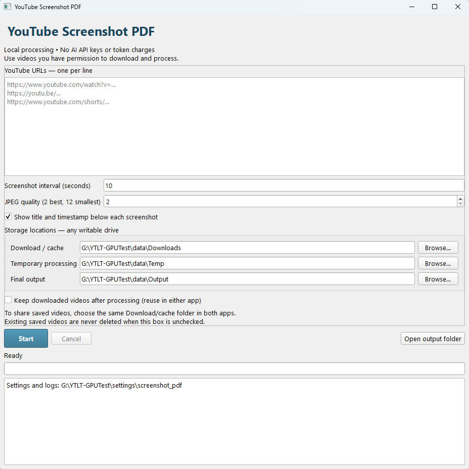

# YouTube Local Tools: YouTube Screenshots to PDF

Paste a list of YouTube links, choose a time interval (for example every 10 seconds), and get **one PDF of screenshots** from all the videos. It's great for turning lectures, tutorials and slide talks into handouts you can read, print or annotate.

Everything runs **on your own computer**, with no cloud service, no API key and no cost per use. The installer sets up two Windows desktop apps:

| App | What it makes |
|---|---|
| **YouTube Screenshots to PDF** | One `.pdf` with a screenshot every *N* seconds from each video, a title page per video and optional time captions under each image. |
| **YouTube Local Transcriber** (bonus) | One timestamped `.txt` transcript for a whole list of videos, using the open-source Whisper speech model on your CPU or NVIDIA GPU. |



> **Download:** get the latest `YouTubeLocalTools-…-Windows-Setup.zip` from the [**Releases page**](../../releases/latest).

---

## Contents

- [Features](#features)
- [System requirements](#system-requirements)
- [Install on Windows (step by step)](#install-on-windows-step-by-step)
- [Using the apps](#using-the-apps)
- [Where your files go](#where-your-files-go)
- [Updating](#updating)
- [Uninstalling](#uninstalling)
- [Troubleshooting](#troubleshooting)
- [Limitations](#limitations)
- [Privacy and responsible use](#privacy-and-responsible-use)
- [For developers](#for-developers)
- [Packaging and releases](#packaging-and-releases)
- [Ongoing maintenance](#ongoing-maintenance)
- [License](#license)

---

## Features

**Both apps**
- Paste many YouTube links at once (one per line). Watch links, `youtu.be` links, Shorts and embed links all work; tracking parameters and duplicate links are handled.
- Videos are processed one at a time, in the order you pasted. If one video fails (private, deleted, region-blocked…), the rest still finish and the output notes the failure.
- You choose the download, temporary-work and output folders, on any drive.
- Optional **Keep downloaded videos** so a video downloaded by one app can be reused by the other without downloading it again.
- Cancel at any time. Unfinished work is cleaned up and existing outputs are never overwritten (`_2`, `_3`… are added instead).

**Screenshots to PDF**
- Any interval, such as `0.5`, `2`, `10` or `60` seconds.
- A4 landscape pages, aspect ratio preserved, exact frame time printed in each caption.
- Adjustable JPEG quality (2 = sharpest, 12 = smallest file).
- Long videos are fine: frames are written to disk one video at a time, not held in memory.
- Bengali and Hindi titles render correctly on the title pages.

**Transcriber**
- Languages: Auto-detect, English, Bengali/Bangla, Hindi. It always *transcribes* and never translates.
- Models: `tiny`, `base`, `small` (the default), `medium`, `large-v3`. A model is downloaded once and then works offline.
- Uses an NVIDIA GPU (CUDA) when one is available and falls back to the CPU automatically.
- Handles multi-hour videos with bounded memory (audio is processed in 60-second chunks).

---

## System requirements

| | Minimum |
|---|---|
| Operating system | Windows 10 or 11, **64-bit** |
| Free disk space | **3 GB** (CPU only) or **8 GB** if you have an NVIDIA GPU, plus room for your videos and outputs |
| Internet | Needed during setup, for downloading YouTube videos, and the first time you use each speech model |
| GPU (optional) | NVIDIA GPU with a current driver. AMD and Intel GPUs work, but transcription runs on the CPU. |
| Administrator rights | **Not** needed |

You do **not** need to install Python, FFmpeg or anything else yourself. Setup handles all of it inside the folder you pick.

---

## Install on Windows (step by step)

1. **Download** the newest `YouTubeLocalTools-<version>-Windows-Setup.zip` from the [Releases page](../../releases/latest). It is under *Assets*. Don't use the green **Code → Download ZIP** button; that gives you the developer source instead.
2. **Extract** the zip: right-click it in File Explorer, choose **Extract All…**, then **Extract**. Don't run anything from inside the zip.
3. Open the extracted folder and **double-click `Setup.bat`**.
   - If Windows shows *"Windows protected your PC"*, click **More info**, then **Run anyway**. This appears because the script isn't code-signed.
4. A folder picker opens. **Choose where to install**, for example `D:\` or your `Documents` folder. Setup creates a `YouTubeLocalTools` folder there. Pick a drive with enough free space.
5. **Wait.** Setup downloads a private copy of Python, the apps' libraries, FFmpeg and Deno. With an NVIDIA GPU it also downloads about 1.3 GB of NVIDIA libraries. Expect 5 to 20 minutes depending on your connection. Keep the window open until it says **Setup finished**.
6. The install folder opens. **Double-click** either shortcut:
   - **YouTube Local Transcriber**
   - **YouTube Screenshots to PDF**

   Tip: right-click a shortcut and choose **Send to → Desktop (create shortcut)** to put it on your desktop.

If setup stops with an error, read the last lines in the window (they are also saved in `setup.log` in the install folder), fix the cause (usually internet or disk space), then run `Setup.bat` again and choose the **same folder**. It picks up where it left off.

**Advanced options:** from a terminal you can run `Setup.bat -InstallDir "D:\YouTubeLocalTools"` to skip the folder picker, or add `-Gpu cpu` to skip the NVIDIA download.

---

## Using the apps

### YouTube Screenshots to PDF

1. Paste YouTube links, one per line.
2. Enter a **screenshot interval** in seconds (use a dot for decimals, such as `0.5`).
3. Choose **JPEG quality** from 2 (best, largest file) to 12 (smallest file). 2 is best for slides and text.
4. Tick **captions** if you want the frame time under each image.
5. Press **Start**. When it finishes, open `youtube_screenshots.pdf` from the output folder.

Small intervals make huge PDFs: a 2-hour video gives about 720 pages at 10 s, but about 14,400 pages at 0.5 s.

### YouTube Local Transcriber

1. Paste YouTube links, one per line.
2. Choose a **Language** (or leave it on *Auto Detect*) and a **Model**. Try `tiny` for a quick first test. `small` is a good balance. `medium` or `large-v3` handle hard audio better but are slower and need more memory.
3. Check the three folders (Download/cache, Temporary, Output).
4. Press **Start**. The first run of a model downloads it.
5. When it finishes, click **Open output folder** and open `youtube_transcripts.txt`.

Example output:

```text
================================================================
VIDEO 1
Title: Example lecture
URL: https://www.youtube.com/watch?v=...
Detected language: English
Device: NVIDIA GPU / CUDA (float16)
Model: small
================================================================

[00:00:00.000] Welcome to the lecture.
[00:00:07.250] Today we will cover a new topic.
```

---

## Where your files go

Everything stays inside the install folder unless you choose other locations in the apps:

| Folder | Contents |
|---|---|
| `data\` | Default download cache, speech models, temporary work and outputs |
| `settings\` | Each app's saved choices and log files (`app.log`, `app-worker.log`, `app-inference.log`) |
| `runtime\` | Private Python and libraries (don't edit) |
| `tools\` | FFmpeg and Deno (don't edit) |

Don't move or rename the install folder after setup. To use a different location, run Setup again and choose a new folder.

---

## Updating

**YouTube changed something and downloads stopped working?** That happens from time to time. Update the downloader. Close both apps, open the install folder, click the address bar, type `cmd` and press Enter, then run:

```bat
bootstrap\uv.exe pip install --python runtime\env\Scripts\python.exe --upgrade "yt-dlp[default]"
```

**New version of the apps:** download the new release, extract it, run `Setup.bat` and choose your **existing install folder**. Your `data` and `settings` are kept.

---

## Uninstalling

Setup doesn't write to the registry or install anything system-wide.

1. Copy anything you want to keep out of the `data` folder (transcripts, PDFs, saved videos).
2. Delete the whole install folder.

> If you used the older `.exe` installer, you can instead run **Uninstall YouTube Local Tools.exe** in the install folder. It keeps your data and settings.

---

## Troubleshooting

| Problem | What to do |
|---|---|
| **"Windows protected your PC"** when running Setup.bat | Click **More info → Run anyway**. If the option is missing, right-click the zip → **Properties** → tick **Unblock** → OK, then extract it again. |
| Setup says **not enough space** | Free up space or choose another drive. You need 3 GB, or 8 GB with an NVIDIA GPU. |
| Setup fails while **downloading** | Check your internet connection. A firewall, VPN or antivirus may be blocking `github.com`, `pypi.org` or `files.pythonhosted.org`. Run Setup again with the same folder. |
| **"FFmpeg was not found"** | Run Setup again with the same folder to repair it. |
| **YouTube / JavaScript challenge warnings** or downloads suddenly fail | Update yt-dlp (see [Updating](#updating)). |
| **Private, members-only, age-restricted or region-locked videos fail** | Expected. The apps don't use your browser login or cookies and don't bypass restrictions. Other videos in the list still finish. |
| **Transcriber shows "CPU" even though I have an NVIDIA GPU** | Update your NVIDIA driver from nvidia.com, then run Setup again with the same folder. Details are in `settings\local_transcriber\app-inference.log`. |
| **Out of memory** / app closes during transcription | Choose a smaller model (`small`, `base` or `tiny`). |
| **"DLL load failed"** | Install Microsoft's [Visual C++ Redistributable (x64)](https://learn.microsoft.com/cpp/windows/latest-supported-vc-redist) and reopen the app. |
| **PDF is enormous or slow** | Use a larger interval or a higher JPEG quality number. |
| Anything else | Look at the logs in `settings\<app>\`. When you [open an issue](../../issues), attach the relevant lines, **after removing personal details**: logs can contain your Windows user name, folder paths, video titles and URLs. |

---

## Limitations

- **Windows only** for one-click setup. `bootstrap/install.py` has macOS code paths (including Apple-silicon GPU support), but there is no tested macOS setup script.
- Transcripts are machine-generated and can contain mistakes, especially with mixed languages, names, technical terms, music, noise or overlapping speakers. There is no speaker identification (diarization). Words at 60-second chunk boundaries can occasionally repeat or go missing.
- Output is plain `.txt` only. There is no SRT or VTT subtitle export yet.
- PDF captions and title pages are images, so PDF text isn't selectable or searchable.
- Live streams, upcoming premieres and playlist-only links aren't supported. Use individual, finished videos.
- Depends on yt-dlp keeping up with YouTube changes. Occasional breakage is normal, and updating yt-dlp usually fixes it.
- The setup scripts and the apps aren't code-signed, so Windows SmartScreen may warn the first time.

---

## Privacy and responsible use

- All speech recognition and PDF generation happen **locally**. Audio, video and transcripts aren't uploaded anywhere. The apps have no cloud-AI or analytics integration, and Hugging Face telemetry is disabled.
- Network access is used only for setup, for downloading YouTube media, and for the first download of each Whisper model from Hugging Face.
- No account, API key or password is needed or stored.
- **Only download and process videos you have the right to use.** Respect YouTube's Terms of Service and the copyright of the creators.

---

## For developers

### Repository layout

```text
Setup.bat                  One-click Windows setup (runs bootstrap\setup.ps1)
bootstrap/
  setup.ps1                Picks the folder, fetches uv, creates the private Python, runs install.py, makes shortcuts
  install.py               Installs pinned libraries, FFmpeg, Deno, NVIDIA/Apple GPU support and validates both apps
  launch.py                Entry point used by the shortcuts: launch.py <screenshot_pdf|local_transcriber>
  assets.json              Pinned download URLs + SHA-256 checksums for uv and Deno
  THIRD-PARTY-NOTICES.txt
apps/
  local_transcriber/       PySide6 GUI + yt-dlp + faster-whisper (see its own README.md)
  screenshot_pdf/          PySide6 GUI + yt-dlp + FFmpeg + Pillow (see its own README.md)
scripts/
  build_release.py         Builds the release zip in dist\
docs/
  RELEASING.md             Maintainer checklist for publishing a GitHub Release
```

### Run an app from source (without Setup)

Each app folder is self-contained and has its own scripts:

1. Install 64-bit **Python 3.11** from [python.org](https://www.python.org/downloads/windows/) and tick **Add Python to PATH**.
2. Install FFmpeg and Deno (for example `winget install Gyan.FFmpeg` and `winget install DenoLand.Deno`), or copy `ffmpeg.exe`, `ffprobe.exe` and `deno.exe` into an app's `tools\` folder.
3. In `apps\local_transcriber` or `apps\screenshot_pdf`, double-click `setup.bat` (this creates `.venv`), then `run.bat`.
4. Optional: `setup_gpu.bat` (transcriber only) installs NVIDIA runtime libraries for the per-app workflow.

The per-app `README.md` files cover each app's internals in detail.

> `run_tests.bat` expects a `tests\` folder, which isn't included in this repository yet.

### Pinned versions

`bootstrap/install.py` pins exact versions (PySide6 6.11.2, yt-dlp 2026.8.19, faster-whisper 1.2.1, CTranslate2 4.8.2, CUDA 12 / cuDNN 9 wheels…). `bootstrap/assets.json` pins uv 0.12.21 and Deno 2.9.7 with SHA-256 checksums. Update both together and test a clean install before releasing.

---

## Packaging and releases

**Can this be a single standalone `.exe`?** Technically yes: each app has a `build_exe.bat` that makes a PyInstaller folder build. For public distribution, the **small setup zip** is the recommended route, for these reasons:

- **Size.** With CUDA support the dependencies are over 2 GB. A standalone build would be huge, and users without NVIDIA GPUs would download it for nothing.
- **Licenses.** Redistributing the FFmpeg binary (GPL) and NVIDIA's CUDA/cuDNN libraries (proprietary EULA) inside your own download brings extra legal obligations. Setup instead downloads them from their official sources on the user's machine.
- **Maintenance.** yt-dlp needs regular updates. In a private environment users can update it with one command, while a frozen `.exe` would need a full rebuild.

The setup zip is about 100 KB, and the end result is the same: users never touch Python or a terminal.

Maintainers: see [`docs/RELEASING.md`](docs/RELEASING.md) for how to build and publish a release.

---

## Ongoing maintenance

Notes for the maintainer:

- **When YouTube breaks downloads** (this happens every few months), bump the `yt-dlp` version in `bootstrap/install.py` and publish a new release. Until then, users can update yt-dlp themselves; see [Updating](#updating).
- **To release a new version:** edit, commit and push in GitHub Desktop. Then on GitHub go to **Releases → Draft a new release**, create a new tag such as `v1.2.0`, and click **Publish release**. The setup zip is built and attached automatically by the [release workflow](.github/workflows/release.yml), usually within a minute or two. Full checklist: [`docs/RELEASING.md`](docs/RELEASING.md).
- **Expect a Windows warning for some users.** Windows may show *"Windows protected your PC"* because the scripts aren't code-signed. The [troubleshooting table](#troubleshooting) explains how to get past it. Removing the warning entirely would need a paid code-signing certificate.

---

## License

The original source code in this repository is released under the [MIT License](LICENSE).

Third-party components that Setup downloads (Python, uv, PySide6/Qt, yt-dlp, FFmpeg, Deno, faster-whisper, CTranslate2, Whisper models, NVIDIA libraries and others) are **not** part of this repository and remain under their own licenses. See [THIRD-PARTY-NOTICES.txt](THIRD-PARTY-NOTICES.txt).

This project isn't affiliated with or endorsed by YouTube or Google.
